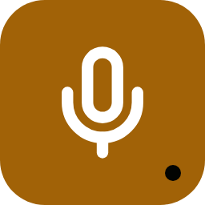
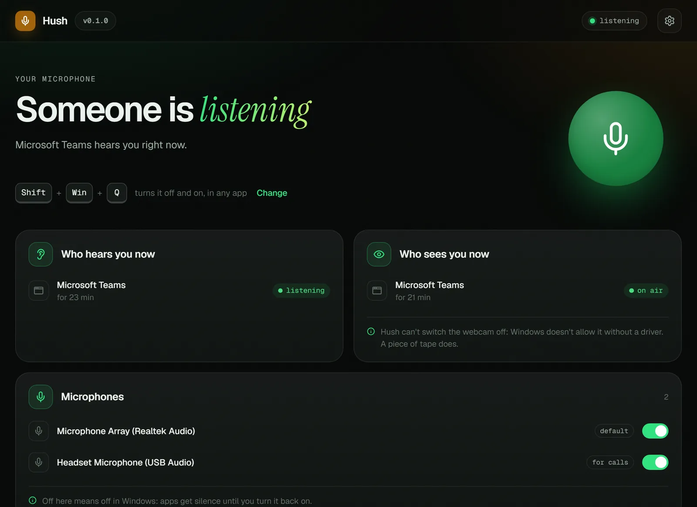
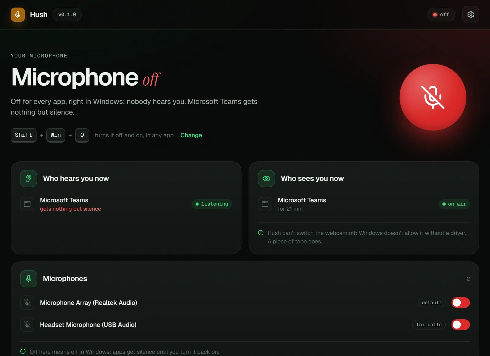
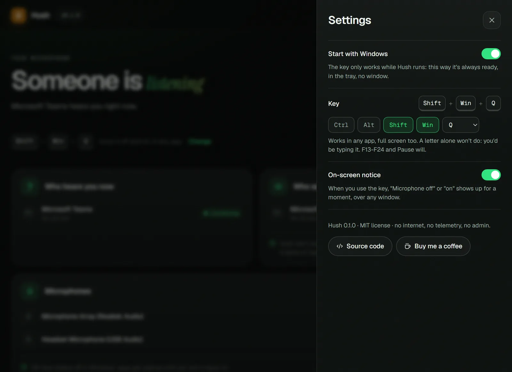

<p align="center">
  
</p>

<h1 align="center">Hush</h1>

<p align="center">
  One key switches your microphone off in every app, and Hush tells you who is listening and who is watching.<br>
  <a href="#english">English</a> · <a href="#italiano">Italiano</a> · <a href="https://davide-mariotti.github.io/apps/hush">Website</a>
</p>

<p align="center">
  <a href="https://ko-fi.com/Z0X32ATNHL"></a>
</p>

<p align="center">
  
</p>
<p align="center">
   
</p>

---

## English

### What it does

- **Win+Shift+Q** switches the microphone off, in every app at once: Teams, Meet, Zoom, Discord, the browser. Press it again and it's back on. It works in any window, full screen too, and you can pick another key.
- One click on the tray icon does the same. The icon tells you how things stand: ochre when the microphone is on and nobody uses it, green when an app is listening right now, red when it's off.
- A small notice says "Microphone off" or "Microphone on" for a moment in the middle of the screen, so you know without looking for the tray.
- Shows who hears you and who sees you right now, microphone and webcam, and which apps used them in the last 30 days, with when and for how long.
- Switches off every microphone you have, one by one if you prefer. A microphone plugged in while Hush has them off gets switched off too.
- Starts with Windows if you ask it to, and speaks Italian or English, following the language of Windows.

### What it doesn't do

- It doesn't switch the webcam off: Windows doesn't let an app do that without a driver of its own. Hush tells you who is using it. For the rest, a piece of tape still works.
- It doesn't listen. Hush never opens the microphone: it reads whether it's on or off, and which apps are using it.
- It doesn't watch your keyboard. The key is registered with Windows: Hush is told about that one combination and nothing else.
- It doesn't mute single apps. It's the microphone itself that goes off, for everyone. For one app at a time there's the Windows volume mixer.
- It doesn't connect to the internet. No telemetry, no auto-updates, no account, no administrator rights. Settings live in `HKCU\SOFTWARE\HushApp`, or in `Hush.ini` in the portable version.
- It doesn't leave you silent by surprise: Windows keeps a microphone off even after Hush closes, so when you exit with the microphone off, Hush asks whether to turn it back on.
- It doesn't run on macOS, Linux, or 32-bit Windows.

### Download

1. Download [Hush.exe](https://github.com/davide-mariotti/Hush/raw/main/Hush.exe) (1.1 MB). Windows 10 or 11, 64-bit, nothing else to install.
2. Put it in a folder that stays put (say `Documents\Tools`), not in Downloads.
3. Double-click it. The first time, SmartScreen may complain because the exe isn't signed: *More info* → *Run anyway*.
4. In the settings (the gear at the top right) turn on *Start with Windows*: the key only works while Hush is running.

**Portable version**: [Hush-portable.zip](https://github.com/davide-mariotti/Hush/raw/main/Hush-portable.zip) (420 KB), the same exe with a `Hush.ini` next to it. Unzip it anywhere, a USB stick too. As long as `Hush.ini` sits next to the exe, the settings are saved in that file and the registry is never touched. That's also why this version can't start with Windows.

### How to use it

- **Win+Shift+Q**, or one click on the tray icon: off. Again: on. The big round button in the window does the same.
- **In the window**: who hears you and who sees you right now (an app still connected to a muted microphone shows up as "gets nothing but silence"), your microphones with a switch each, and the last 30 days of microphone and webcam use.
- **In the tray**: hover the icon to see who is listening. Right-click for *Open Hush* and *Exit*. Closing the window leaves Hush in the tray.
- **The key**: in the settings you pick the modifiers (Ctrl, Alt, Shift, Win) and the key. A letter alone won't do, you'd be typing it; F13-F24 and Pause can go alone. If another app already owns the combination, Hush tells you and keeps the old one.

### How it works

1. Off means off in Windows: Hush uses Core Audio, the same switch as *Settings › System › Sound › Input*, on every active microphone. Apps stay connected but get silence; some, like Teams, notice and tell you the microphone is off in Windows.
2. The key goes through `RegisterHotKey`: no keyboard hook, nothing to install. Win+Shift+A and Win+Alt+K, the obvious ones, are often taken already (Windows 11 keeps Win+Alt+K for calls); if Win+Shift+Q is taken too, Hush tries Ctrl+Alt+M and then Ctrl+Shift+F12.
3. Who is listening comes from the records Windows keeps for its own microphone and camera icon in the tray and for *Settings › Privacy & security › Microphone*, under Recent activity. Hush reads them once a second: an app that started and hasn't stopped is using it now. Windows keeps only the last session of each app, so that's what the 30-day list shows.
4. Every second Hush also checks the microphones: one plugged in while they're all off gets switched off; one switched back on from Windows' settings is left alone, and the tray turns ochre or green.

### Build from source

No Visual Studio needed: Windows already ships the C# compiler of .NET Framework 4.

```cmd
build.bat
```

You get `Hush.exe` and `Hush-portable.zip` next to the sources. The WebView2 libraries in `lib\` and the window in `ui\` (plain HTML, CSS and JavaScript, no build step) are packed inside the exe. `build.bat` runs `Hush.exe --selftest`, which checks what the key switches, which keys are allowed, how apps and their time of use are read, and that Core Audio and the registry answer. The icons, the app's and the tray's, come from `icon/make-icons.py` (Python, Pillow and Chrome), drawn with [Lucide](https://lucide.dev) glyphs, the same ones the window uses.

### Support

If Hush saved you from a "can everyone hear me?" moment, you can [buy me a coffee on Ko-fi](https://ko-fi.com/Z0X32ATNHL). That's how the next app gets written.

### License

[MIT](LICENSE). The libraries and fonts inside the exe keep their own licenses (BSD, SIL OFL): the list is in [lib/README.md](lib/README.md).

---

## Italiano

### Cosa fa

- **Win+Shift+Q** spegne il microfono, in tutte le app insieme: Teams, Meet, Zoom, Discord, il browser. Lo premi di nuovo e torna acceso. Funziona in qualsiasi finestra, anche a schermo intero, e il tasto lo puoi cambiare.
- Un clic sull'icona nella tray fa la stessa cosa. L'icona ti dice com'è la situazione: ocra quando il microfono è acceso e nessuno lo usa, verde quando un'app ti sta ascoltando, rossa quando è spento.
- Un piccolo avviso scrive "Microfono spento" o "Microfono acceso" per un attimo in mezzo allo schermo, così lo sai senza cercare la tray.
- Ti fa vedere chi ti sente e chi ti vede in questo momento, microfono e webcam, e quali app li hanno usati negli ultimi 30 giorni, con quando e per quanto.
- Spegne tutti i microfoni che hai, uno per uno se preferisci. Un microfono collegato mentre Hush li tiene spenti viene spento anche lui.
- Si avvia con Windows, se glielo chiedi, e parla italiano o inglese, in base alla lingua di Windows.

### Cosa non fa

- Non spegne la webcam: Windows non lo permette a un'app senza un driver suo. Hush ti dice chi la sta usando. Per il resto, un pezzo di nastro adesivo funziona ancora.
- Non ascolta. Hush non apre mai il microfono: legge se è acceso o spento, e quali app lo stanno usando.
- Non spia la tastiera. Il tasto è registrato in Windows: a Hush arriva quella combinazione e nient'altro.
- Non silenzia le singole app. È il microfono stesso a spegnersi, per tutti. Per un'app alla volta c'è il mixer del volume di Windows.
- Non si collega a internet. Niente telemetria, niente aggiornamenti automatici, niente account, niente permessi di amministratore. Le impostazioni stanno in `HKCU\SOFTWARE\HushApp`, o in `Hush.ini` nella versione portable.
- Non ti lascia muto a sorpresa: Windows tiene spento il microfono anche dopo che Hush si chiude, quindi se esci con il microfono spento Hush ti chiede se riaccenderlo.
- Non gira su macOS, Linux, né su Windows a 32 bit.

### Scaricarlo

1. Scarica [Hush.exe](https://github.com/davide-mariotti/Hush/raw/main/Hush.exe) (1,1 MB). Windows 10 o 11 a 64 bit, nient'altro da installare.
2. Mettilo in una cartella che non sposti (tipo `Documenti\Strumenti`), non in Download.
3. Doppio clic. La prima volta SmartScreen potrebbe lamentarsi perché l'exe non è firmato: *Ulteriori informazioni* → *Esegui comunque*.
4. Nelle impostazioni (l'ingranaggio in alto a destra) attiva *Avvia con Windows*: il tasto funziona solo mentre Hush è acceso.

**Versione portable**: [Hush-portable.zip](https://github.com/davide-mariotti/Hush/raw/main/Hush-portable.zip) (420 KB), lo stesso exe con accanto un `Hush.ini`. Lo scompatti dove vuoi, anche su una chiavetta. Finché `Hush.ini` sta vicino all'exe, le impostazioni si salvano in quel file e il registro non viene mai toccato. Per lo stesso motivo questa versione non si avvia con Windows.

### Come si usa

- **Win+Shift+Q**, o un clic sull'icona nella tray: spento. Di nuovo: acceso. Il grande pulsante rotondo nella finestra fa lo stesso.
- **Nella finestra**: chi ti sente e chi ti vede adesso (un'app ancora collegata a un microfono spento compare con "riceve solo silenzio"), i tuoi microfoni con un interruttore ciascuno, e gli ultimi 30 giorni di uso di microfono e webcam.
- **Nella tray**: passa col mouse sull'icona per vedere chi ti sta ascoltando. Tasto destro per *Apri Hush* ed *Esci*. Chiudere la finestra lascia Hush nella tray.
- **Il tasto**: nelle impostazioni scegli i modificatori (Ctrl, Alt, Shift, Win) e il tasto. Una lettera da sola no, la scriveresti; F13-F24 e Pausa possono andare da soli. Se un'altra app usa già quella combinazione, Hush te lo dice e tiene quella di prima.

### Come funziona

1. Spento vuol dire spento in Windows: Hush usa Core Audio, lo stesso interruttore di *Impostazioni › Sistema › Audio › Input*, su ogni microfono attivo. Le app restano collegate ma ricevono silenzio; alcune, come Teams, se ne accorgono e ti dicono che il microfono è spento in Windows.
2. Il tasto passa da `RegisterHotKey`: niente hook della tastiera, niente da installare. Win+Shift+A e Win+Alt+K, quelli più ovvi, spesso sono già presi (Windows 11 tiene Win+Alt+K per le chiamate); se anche Win+Shift+Q è occupato, Hush prova Ctrl+Alt+M e poi Ctrl+Shift+F12.
3. Chi ti ascolta viene dai registri che Windows tiene per la sua icona di microfono e webcam nella tray e per *Impostazioni › Privacy e sicurezza › Microfono*, alla voce Attività recente. Hush li legge una volta al secondo: un'app che ha iniziato e non ha ancora finito lo sta usando adesso. Windows tiene solo l'ultima sessione di ogni app, ed è quella che vedi nell'elenco dei 30 giorni.
4. Ogni secondo Hush controlla anche i microfoni: uno collegato mentre sono tutti spenti viene spento; uno riacceso dalle impostazioni di Windows resta acceso, e la tray diventa ocra o verde.

### Compilarlo

Non serve Visual Studio: Windows ha già il compilatore C# di .NET Framework 4.

```cmd
build.bat
```

Ottieni `Hush.exe` e `Hush-portable.zip` accanto ai sorgenti. Le librerie di WebView2 in `lib\` e la finestra in `ui\` (HTML, CSS e JavaScript semplici, niente build) finiscono dentro l'exe. `build.bat` lancia `Hush.exe --selftest`, che controlla cosa spegne il tasto, quali tasti sono ammessi, come si leggono le app e i loro orari, e che Core Audio e il registro rispondano. Le icone, quella dell'app e quelle della tray, le genera `icon/make-icons.py` (Python, Pillow e Chrome), con i glifi di [Lucide](https://lucide.dev), gli stessi della finestra.

### Supporto

Se Hush ti ha salvato da un "ma mi sentite tutti?", puoi [offrirmi un caffè su Ko-fi](https://ko-fi.com/Z0X32ATNHL). È così che nasce la prossima app.

### Licenza

[MIT](LICENSE). Le librerie e i font dentro l'exe hanno le loro licenze (BSD, SIL OFL): l'elenco è in [lib/README.md](lib/README.md).
